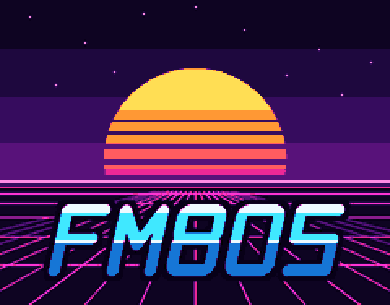

<p align="center"></p>

# FM80S — un synthé-looper synthwave pour le M-VAVE FM-1

Un firmware libre (GPL-3.0) **par Floydus** qui fait du FM-1, le petit synthé de poche de M-VAVE, un **synthé-looper** : on joue une boucle au clavier, elle tourne, on en joue une autre avec un autre instrument par-dessus ; ou on la programme pas à pas ; les boucles s'enchaînent en une song.

FM80S est un fork de **[SLOOP 2.5](https://github.com/isod89/sloop-fm1)** (isod89), lui-même fondé sur **[Felucca](https://github.com/hugelton/Felucca)** (Leo Kuroshita, Hügelton Instruments). Il lui ajoutera, dans l'ordre : un FM-1 virtuel dans le navigateur, **8 pistes au lieu de 4**, et une identité synthwave forte. Pourquoi ce choix : [`docs/09_COMPARAISON.md`](docs/09_COMPARAISON.md).

## Où en est-on

- **FM80S 0.1 (F0-01)** : c'est SLOOP 2.5 sous le nom FM80S, avec son image de démarrage et sa page ABOUT. Le son et les fonctions sont exactement ceux de SLOOP 2.5 : les 182 rendus de référence de SLOOP sont identiques.
- **Ensuite :** le FM-1 virtuel dans le navigateur (F0-02, F0-03), puis les 8 pistes (F1), puis le thème, les sons et les écrans synthwave (F2). Le détail : [`docs/06_BACKLOG.md`](docs/06_BACKLOG.md).

## Le mode d'emploi

Tant que FM80S se joue comme SLOOP 2.5, le mode d'emploi est celui de SLOOP :
- [`DEMARRAGE-RAPIDE-FR.md`](DEMARRAGE-RAPIDE-FR.md), en français, avec « Un beat en soixante secondes » ;
- [`GUIDE.md`](GUIDE.md), le guide complet ;
- [`SLOOP.md`](SLOOP.md), le manuel.

Ces fichiers parlent de « SLOOP » : c'est le même firmware.

## Installer FM80S sur ton FM-1

> Un firmware non officiel s'installe à tes risques, sans garantie. Le pas à pas ci-dessous est celui de SLOOP, qui a été éprouvé ; on peut toujours revenir au firmware d'origine (plus bas).

**Avant tout, garde de quoi revenir en arrière :** sur [www.m-vave.com/download](https://www.m-vave.com/download), télécharge le firmware officiel **FM-1 V15** (rubrique *PC Firmware*) et garde le fichier `FM-1.fwsc` qu'il contient.

Ensuite, dans le Terminal, depuis le dossier `FM80S` :

1. Construis le firmware, si ce n'est pas déjà fait (voir « Construire le firmware » plus bas) :

   ```bash
   ./build.sh
   ```

2. Prépare la page d'installation sur ton Mac :

   ```bash
   python3 web/make_site.py build/fm80s.fwsc 0.1 build/site
   ```

3. Lance un petit serveur web local. Il tourne tant que la fenêtre du Terminal reste ouverte ; tu l'arrêtes avec **ctrl + C** à la fin :

   ```bash
   python3 -m http.server 8000 --directory build/site
   ```

4. Ouvre **Google Chrome** (pas Safari : Safari ne sait pas parler MIDI à une page web), et va à l'adresse `http://localhost:8000/webapp/installer/`.
5. Branche le FM-1 à ton Mac avec un câble USB **de données** (pas un câble de charge seule), **directement**, sans hub.
6. Clique sur **INSTALL**, autorise l'accès MIDI quand Chrome le demande, et attends *Done*. Le FM-1 redémarre sur l'image FM80S.
7. Débranche et rebranche le FM-1 une fois : le Mac trouve alors son entrée audio USB.

**Pour revenir au firmware d'origine :** sur la même page, ouvre **Return to the official firmware (V15)**. Sauvegarde d'abord ta musique avec l'éditeur (*Projects → Backup*), puis choisis le `FM-1.fwsc` de V15 : la page n'accepte que ce fichier exact. L'outil officiel de M-VAVE, M-UPGRADE, marche aussi.

**Si quelque chose se passe mal :**
- FM80S ne démarre plus : allume le FM-1 en tenant **OCT−** enfoncé (l'écran affiche *FM80S USB RESCUE*), puis refais l'installation.
- L'installation a été coupée : le FM-1 reste en mode mise à jour ; clique de nouveau sur INSTALL, elle se termine.
- Si le FM-1 ne démarre plus du tout, la réparation passe par [FM-1-transporter](https://github.com/kurogedelic/FM-1-transporter).

## Construire le firmware (Mac)

Le détail est dans [`BUILDING.md`](BUILDING.md), celui de SLOOP. Sur un Mac, il faut :

- **Docker Desktop**, lancé : la chaîne de compilation de JieLi ne tourne que sous Linux x86-64, alors chaque outil tourne dans un conteneur `linux/amd64` (Rosetta sur les puces Apple) ;
- **Pillow** pour Python :

  ```bash
  pip3 install --user Pillow
  ```

- **La chaîne JieLi** (clang 4.0.1 pour pi32v2, environ 26 Mo, installée dans `~/.jieli`) :

  ```bash
  tools/get_toolchain.sh
  ```

- **3 fichiers du SDK AC79 de JieLi** (Apache-2.0, quelques Ko), dans `~/fw-AC79_AIoT_SDK/cpu/wl82/tools/`. Pas besoin de cloner tout le SDK : cette commande les télécharge un par un, et `build.py` vérifie leurs empreintes :

  ```bash
  for f in uboot.boot cfg_tool.bin cfg/eq_cfg_hw.bin; do mkdir -p "$(dirname ~/fw-AC79_AIoT_SDK/cpu/wl82/tools/$f)" && curl -fsSL -o ~/fw-AC79_AIoT_SDK/cpu/wl82/tools/$f https://gitee.com/Jieli-Tech/fw-AC79_AIoT_SDK/raw/AC79NN_SDK_V1.2.1_2023-12-13/cpu/wl82/tools/$f; done
  ```

Puis le firmware (`build/fm80s.fwsc`, en quelques secondes) :

```bash
./build.sh
```

Et les tests sur l'ordinateur (environ 3 minutes) :

```bash
tests/run_tests.sh
```

## Les documents du projet

[`docs/03_PRD.md`](docs/03_PRD.md) (la vision), [`docs/04_SPEC.md`](docs/04_SPEC.md) (ce que FM80S change dans SLOOP), [`docs/05_ARCHITECTURE.md`](docs/05_ARCHITECTURE.md), [`docs/06_BACKLOG.md`](docs/06_BACKLOG.md), [`docs/08_DECISIONS.md`](docs/08_DECISIONS.md), [`docs/10_FAISABILITE_8_PISTES.md`](docs/10_FAISABILITE_8_PISTES.md), et [`CLAUDE.md`](CLAUDE.md) (les règles de travail).

## Crédits, licence et marques

- **FM80S** : Floydus.
- **SLOOP** : isod89 ([isod89/sloop-fm1](https://github.com/isod89/sloop-fm1)).
- **Felucca** : Leo Kuroshita (@kurogedelic), [Hügelton Instruments](https://hugelton.com).
- Le reste des crédits (polices, échantillons, code repris) : [`LICENSING.md`](LICENSING.md).

GPL-3.0-only, texte complet dans [`LICENSE`](LICENSE). « SLOOP » est le nom du projet d'isod89 ; « Felucca » et « Hügelton Instruments » sont des noms de Hügelton Instruments ; FM80S ne les utilise que pour les créditer. « M-VAVE » et « FM-1 » sont des marques de leurs propriétaires : FM80S est un firmware indépendant, ni affilié à M-VAVE, ni approuvé, ni soutenu par la société. Les instruments cités pour décrire un caractère sonore (Juno, DX7, OP-1…) sont des marques de leurs propriétaires ; FM80S n'en reprend ni les noms, ni les graphismes.
